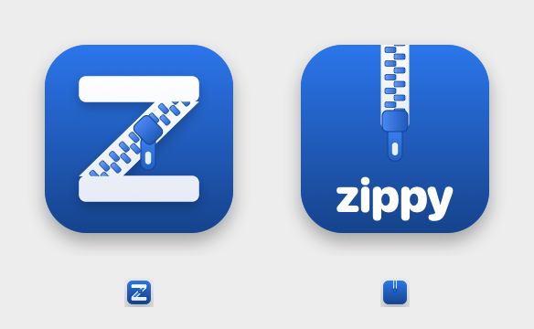

# Zippy

Zippy opens archives on your Mac as drives in Finder, the same way a `.dmg` file does.
Double-click a ZIP, browse and edit its contents like a normal folder, then eject it.
Your changes are written back into the archive when you eject.

Zippy has no window of its own. It starts when you open an archive and quits right after.
The app's dialogs and messages are currently in German.

## Features

- **Archives as drives:** each archive appears on the desktop and in the Finder sidebar
  with an eject button. Several archives can be open at once.
- **Edit in place:** add files by drag and drop, delete, rename, move, create folders and
  change files. Everything is saved into the archive when you eject.
- **Password-protected ZIPs:** ZipCrypto and WinZip AES (128/192/256). Zippy asks for the
  password and can store it in your keychain.
- **Lazy extraction:** a file is only extracted when it is first read, so large archives
  open quickly.

### Supported formats

| Format | Open | Edit and save |
|---|---|---|
| ZIP (`.zip`) | yes | yes |
| TAR (`.tar`, `.tar.gz`/`.tgz`, `.tar.bz2`/`.tbz`, `.tar.Z`) | yes | yes, same format and compression |
| 7-Zip, RAR, `.tar.xz` | not yet | not yet |

## Requirements

- macOS 15.4 or later (macOS 26 or later recommended, see below)
- [FUSE-T](https://www.fuse-t.org), free for personal use:

  ```bash
  brew install macos-fuse-t/cask/fuse-t
  ```

### On macOS 26 and later

FUSE-T can mount volumes through Apple's FSKit instead of a local network share. Zippy
uses this automatically when it is available, and then the archives show up as real
drives (named after the archive, in the sidebar under Locations).

1. Make sure FUSE-T's FSKit component is installed: `/Applications/fuse-t.app` must exist.
   The FUSE-T installer only adds it when it runs on macOS 26 or later. If you installed
   FUSE-T before upgrading macOS, reinstall it.
2. Turn on **fuse-t** in System Settings → General → Login Items & Extensions →
   File System Extensions.
3. The first time you open an archive, Zippy asks for an administrator password once.
   It sets up a small launch daemon that creates the folder `/Volumes/Zippy` at every
   startup. Only Finder volumes under `/Volumes` get a sidebar entry and an eject button.

If any of this is missing or you decline the password prompt, Zippy falls back to
FUSE-T's network-share mode. Archives still open, but appear under the server "fuse-t"
in the Finder sidebar.

## Installation

There is no prebuilt release yet. To build it yourself you need Xcode and
[XcodeGen](https://github.com/yonaskolb/XcodeGen):

```bash
brew install xcodegen
./build.sh
```

`build.sh` builds libarchive on first run, generates the Xcode project, builds the app
with an ad-hoc signature and registers it with Launch Services. The app ends up in
`build/Build/Products/Debug/Zippy.app`; copy it to `/Applications` if you like.

## Usage

- Right-click an archive and choose **Open With → Zippy**. To use Zippy for every archive
  of a type, select one, press ⌘I, pick Zippy under "Open with" and click "Change All…".
- The archive opens as a drive and a Finder window shows its contents.
- Edit as you like, then eject the drive (eject button, ⌘E, or drag it to the trash).

### What happens when you eject

- If nothing changed, the archive is left untouched. Just browsing never rewrites it.
- Otherwise Zippy writes a new archive next to the original and replaces it.
- If the original was changed by someone else while it was open, it is left alone and
  your changes are saved as "Name (bearbeitet).zip" next to it.
- If saving fails, a copy with your changes is placed on the desktop and a notification
  tells you so.

Good to know:

- All files are recompressed when saving. Encrypted ZIPs stay encrypted with the same
  password, always as AES-256.
- Finder's helper files (`.DS_Store`, `._*` and similar) are visible on the drive but
  never saved into the archive. Finder tags and other extended attributes are not saved.
- A ZIP file comment is lost when the archive is saved.
- If the background process crashes before you eject, unsaved changes are lost.
- An archive stays read-only if Zippy can't replace the file (no write permission) or
  if it contains encrypted files and no password was given.

## Known limitations

- The Finder sidebar only shows generic drive icons. The archive icon appears on the
  desktop and in the Finder window.
- When opening a drive, Finder briefly shows a generic folder icon. This comes from the
  FUSE-T layer, not from Zippy.
- Big compressed TAR files open more slowly than ZIPs: TAR has no table of contents, so
  each file is extracted by reading from the start of the archive.

## Uninstall

Delete `Zippy.app`. If the `/Volumes/Zippy` helper was set up, remove it with:

```bash
sudo launchctl bootout system/dev.zippy.volumes-folder
sudo rm /Library/LaunchDaemons/dev.zippy.volumes-folder.plist
```

## How it works

Zippy reads archives with [libarchive](https://www.libarchive.org) and serves them as a
user-space file system through FUSE-T. Each mounted archive runs in its own small
background process that ends when the drive is ejected. A second variant with its own
FSKit extension (no FUSE-T needed) is in the code, but requires a paid Apple Developer
account and is not finished.

Development notes (in German) are in [docs/DEVELOPMENT.md](docs/DEVELOPMENT.md).

## License

Zippy is licensed under the [PolyForm Noncommercial License 1.0.0](LICENSE.md). You may use,
change and share it for any noncommercial purpose, for example personal use, research,
education, or use by charities and public institutions. Commercial use is not permitted.
This makes Zippy source-available rather than open source in the OSI sense.

Third-party parts keep their own licenses (FUSE headers: LGPL, libarchive: BSD). FUSE-T
itself is free for personal use and needs its own license for commercial use.
