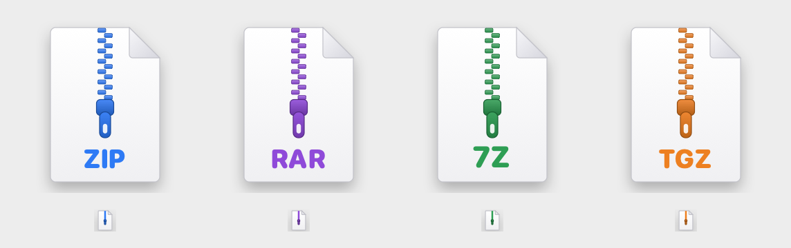

# Zippy

Öffnet ZIP-Archive als Volumes im Finder, wie eine .dmg. Ziel: gratis im Mac App Store.

## Projekt erzeugen

Das Xcode-Projekt wird aus `project.yml` generiert:

    brew install xcodegen
    xcodegen generate
    open Zippy.xcodeproj

## Sequoia-Prototyp testen

macOS 15 kann FSKit-Volumes nur aus Block-Geräten bauen. Zippy hängt das ZIP deshalb als
rohes Disk-Image an (APFS-Clone, auf 512 Byte aufgefüllt) und übergibt es an DiskImageMounter.
Die Erweiterung `ZippyFS` erkennt die ZIP-Signatur und hängt ein Volume mit `Zippy-Test.txt` ein.

1. In `project.yml` Team-ID und Bundle-ID eintragen, `xcodegen generate`.
2. In Xcode das Schema *Zippy* bauen und starten.
3. Systemeinstellungen → Allgemein → Anmeldeobjekte & Erweiterungen → Dateisystemerweiterungen → *Zippy* aktivieren.
4. In der App „ZIP mounten …“ wählen.
5. Logs beobachten:

       log stream --predicate 'subsystem == "dev.zippy.Zippy.ZippyFS"'

Erfolg = Volume „Zippy“ erscheint im Finder. Kommt kein `probe:` im Log, fragt FSKit
bei roh angehängten Images nicht nach: dann `FSMediaTypes` in `project.yml` anpassen.

### Bisher geprüft (ohne Xcode, macOS 15.8)

- `hdiutil attach` eines rohen ZIPs schneidet auf 512-Byte-Blöcke ab → ZIP-Inhaltsverzeichnis fehlt.
- Mit Clone und Auffüllen ist das ZIP vollständig auf dem Block-Gerät.
- DiskImageMounter hängt so ein Image an und lässt es angehängt, auch ohne erkanntes Dateisystem.

### Ergebnis 12.11.2026 (mit Xcode 26.3, ad hoc signiert, `./build.sh`)

- DiskArbitration findet ZippyFS und prüft das roh angehängte ZIP damit
  (`probed disk ... with zippy_fskit`). `FSMediaTypes` → `Partitionless` passt.
- fskit_agent startet die Erweiterung, AMFI beendet sie sofort:
  "Code has restricted entitlements, but the validation of its code signature failed."
  `com.apple.developer.fskit.fsmodule` braucht ein Provisioning-Profil (Apple-ID / Team).
- Logs lesen mit `/usr/bin/log` (in zsh kann `log` überdeckt sein).
- Kostenloses Personal Team (Apple-ID in Xcode) reicht nicht: "Personal development teams ...
  do not support the FSKit Module capability." → bezahlter Apple-Developer-Account nötig.

## ArchiveCore (ZIP-Kern)

Swift-Package mit libarchive: liest das ZIP-Inhaltsverzeichnis in einen Ordnerbaum
und liefert Dateiinhalte an beliebigen Stellen (beim ersten Zugriff in einen Cache entpackt).

    ./scripts/build-libarchive.sh          # einmalig: libarchive bauen (Prüfsumme wird geprüft)
    cd ArchiveCore && swift test           # Tests
    swift run archivetool ls  datei.zip    # Inhalt anzeigen
    swift run archivetool cat datei.zip pfad/im/zip

Vorerst nicht unterstützt: verschlüsselte ZIPs, LZMA/XZ-komprimierte Einträge.

## Zippy mit FUSE-T (aktuelle Variante)

Voraussetzung: FUSE-T (`brew install macos-fuse-t/cask/fuse-t`), kostenlos für
nicht-kommerzielle Nutzung. Bauen mit `./build.sh`, die FSKit-Variante mit `./build.sh fskit`.

Ablauf wie bei einer .dmg:
- Doppelklick auf ein ZIP (bzw. `open -a Zippy datei.zip`) → Zippy startet pro Archiv
  einen Hilfsprozess `Zippy --serve …`, öffnet ein Finder-Fenster und beendet sich.
- Der Hilfsprozess stellt das Volume bereit, bis es ausgeworfen wird, und beendet sich dann.
- Mountpunkte liegen unter `/private/tmp/Zippy-<uid>/<Name>` (FUSE-T darf nicht nach /Volumes).

Erkenntnisse aus den Tests (FUSE-T 1.2.9):
- Ein Volume pro Prozess, Mounten und `fuse_loop` im Haupt-Thread. Mehrere Volumes in
  Hintergrund-Threads eines Prozesses → Aushängen wird nicht erkannt.
- `fuse_loop_mt` kehrt nach dem Aushängen nie zurück.
- SIGPIPE muss ignoriert werden.
- FUSE-T-Volumes sind NFS: macOS fragt Zippy einmalig nach „Zugriff auf Netzwerk-Volumes“
  (beim Öffnen des Finder-Fensters). Bis zur Antwort blockiert der Zugriff.
- Prozesse, die ein FUSE-T-Volume testen, nicht in einer Sandbox starten (lokale
  Netzwerkverbindung zum NFS-Server wird sonst blockiert → hängender Mount).
- Hängt doch einmal ein Mount: `umount -f <pfad>` (ggf. mit sudo).

## Zwei Varianten, eine App

Die App-Logik liegt in `Zippy/Shared` (Archive entgegennehmen, Finder-Fenster, beenden).
Dahinter steckt die Schnittstelle `ArchiveMounting` (`mount(archiv) → Mountpunkt`) mit zwei
austauschbaren Umsetzungen; welche, entscheidet allein das Target:

| Target | Ordner | Technik | Voraussetzung |
|---|---|---|---|
| `Zippy` | `Zippy/FUSE` | FUSE-T (Standard) oder macFUSE, ein Hilfsprozess pro Volume | FUSE-T installiert |
| `Zippy-FSKit` | `Zippy/FSKit` | eigene FSKit-Erweiterung `ZippyFS`, Sandbox, App-Store-tauglich | bezahlter Developer-Account |

Beide lesen ZIPs über `ArchiveCore`. Die FSKit-Variante hängt das ZIP als Zippy-Image an
(`ArchiveCore/ZippyImage.swift`: APFS-Clone + Auffüllen auf 4096 + Trailer mit ZIP-Länge und Name),
weil FSKit auf macOS 15 nur Block-Geräte kann. `ZippyFS` erkennt den Trailer und liest das
ZIP blockweise über `BlockSource`.

Stand FSKit-Variante (ohne Account geprüft): Image wird korrekt angelegt, macOS hängt es
nur lesend an und prüft es mit `zippy_fskit`; danach beendet der Signatur-Wächter die
ad hoc signierte Erweiterung. Mit Team-ID in `project.yml` sollte der Rest laufen (ungetestet).

Backend der FUSE-Variante einstellen (nicht `defaults write dev.zippy.Zippy …`: ein alter
Sandbox-Container des ersten Prototyps lenkt das sonst um):

    defaults write ~/Library/Preferences/dev.zippy.Zippy.plist Backend macfuse   # Standard: FUSE-T

### Warum FUSE-T Standard ist und nicht macFUSE (Stand macFUSE 5.2, macOS 15.8)

macFUSE mountet über FSKit (ohne Kernel-Erweiterung) und die Volumes gelten als lokal, aber:
- Sie erscheinen nicht in der Finder-Seitenleiste (macFUSE mountet an DiskArbitration vorbei).
- Finder/`diskutil` können nicht auswerfen; Zippy hängt sich dafür selbst in DiskArbitration ein.
- Nur ein Volume gleichzeitig (nach Aktivieren der Erweiterung); weitere scheitern und
  hinterlassen verwaiste Hilfs-Laufwerke, die nur das Festplattendienstprogramm löst.
- Leerzeichen und Umlaute im Mountpfad lassen den Mount scheitern.
- Unter /Volumes bleiben nach dem Aushängen leere Ordner, die nur root löschen kann.

FUSE-T dagegen: stabil, mehrere Volumes, Auswerfen im Finder; Nachteil: alle Volumes stehen
in der Seitenleiste unter dem Server „fuse-t“ und macOS fragt einmal nach „Netzwerk-Volumes“.
Das .dmg-Verhalten (eigener Eintrag pro ZIP) liefert realistisch nur die FSKit-Variante.

## Icons

Dokument-Icons pro Archivtyp im Stil der macOS-Dokumentsymbole, farbcodiert
(ZIP blau, RAR violett, 7Z grün, TGZ orange). Selbst gezeichnet mit CoreGraphics:

    swift scripts/make-icons.swift Zippy/Resources/Icons docs/icons.png

Eingebunden ist vorerst nur `zip.icns` (Zippy kann bisher nur ZIP). Der Finder zeigt es,
wenn Zippy die Standard-App für ZIP ist.
