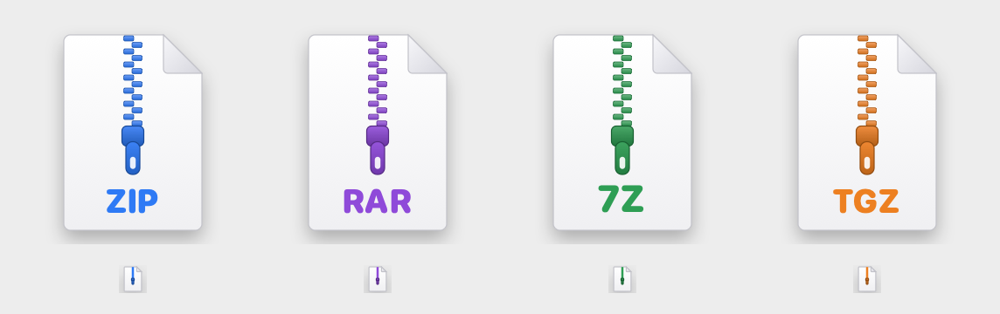
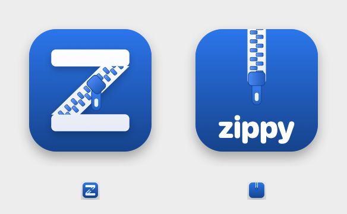

# Zippy – Entwicklungsnotizen

Interne Notizen zur Weiterentwicklung (Deutsch). Für Nutzer siehe [README.md](../README.md).

Öffnet ZIP- und TAR-Archive als Volumes im Finder, wie eine .dmg. Ziel: gratis im Mac App Store.

## Projekt erzeugen

Das Xcode-Projekt wird aus `project.yml` generiert:

    brew install xcodegen
    xcodegen generate
    open Zippy.xcodeproj

## Sequoia-Prototyp testen

macOS 15 kann FSKit-Volumes nur aus Block-Geräten bauen. Zippy hängt das ZIP deshalb als
rohes Disk-Image an (APFS-Clone, auf 512 Byte aufgefüllt) und übergibt es an DiskImageMounter.
Die Erweiterung `ZippyFS` erkennt die ZIP-Signatur und hängt ein Volume mit `Zippy-Test.txt` ein.

1. In `project.yml` Team-ID und Bundle-ID eintragen, `xcodegen generate`.
2. In Xcode das Schema *Zippy* bauen und starten.
3. Systemeinstellungen → Allgemein → Anmeldeobjekte & Erweiterungen → Dateisystemerweiterungen → *Zippy* aktivieren.
4. In der App „ZIP mounten …“ wählen.
5. Logs beobachten:

       log stream --predicate 'subsystem == "dev.zippy.Zippy.ZippyFS"'

Erfolg = Volume „Zippy“ erscheint im Finder. Kommt kein `probe:` im Log, fragt FSKit
bei roh angehängten Images nicht nach: dann `FSMediaTypes` in `project.yml` anpassen.

### Bisher geprüft (ohne Xcode, macOS 15.8)

- `hdiutil attach` eines rohen ZIPs schneidet auf 512-Byte-Blöcke ab → ZIP-Inhaltsverzeichnis fehlt.
- Mit Clone und Auffüllen ist das ZIP vollständig auf dem Block-Gerät.
- DiskImageMounter hängt so ein Image an und lässt es angehängt, auch ohne erkanntes Dateisystem.

### Ergebnis 12.11.2026 (mit Xcode 26.3, ad hoc signiert, `./build.sh`)

- DiskArbitration findet ZippyFS und prüft das roh angehängte ZIP damit
  (`probed disk ... with zippy_fskit`). `FSMediaTypes` → `Partitionless` passt.
- fskit_agent startet die Erweiterung, AMFI beendet sie sofort:
  "Code has restricted entitlements, but the validation of its code signature failed."
  `com.apple.developer.fskit.fsmodule` braucht ein Provisioning-Profil (Apple-ID / Team).
- Logs lesen mit `/usr/bin/log` (in zsh kann `log` überdeckt sein).
- Kostenloses Personal Team (Apple-ID in Xcode) reicht nicht: "Personal development teams ...
  do not support the FSKit Module capability." → bezahlter Apple-Developer-Account nötig.

## Release bauen

    ./scripts/make-release.sh      # → build/release/Zippy-<version>.dmg und .sha256

Version aus `MARKETING_VERSION` in `project.yml`. Baut Release für arm64 und x86_64,
signiert ad hoc mit Hardened Runtime und packt ein DMG mit Programme-Verknüpfung,
„Read Me First.txt“ und dem App-Symbol als Volume-Symbol. Ohne bezahlten Account weder
Developer-ID noch Notarisierung: Gatekeeper lehnt die heruntergeladene App ab
(`spctl -a -vv` → rejected), bis man sie unter Datenschutz & Sicherheit freigibt. Das
„Apple Development“-Zertifikat des kostenlosen Accounts hilft dabei nicht und trüge die
E-Mail-Adresse in die Signatur, darum ad hoc.

## ArchiveCore (Archiv-Kern)

Swift-Package mit libarchive: liest das Inhaltsverzeichnis (ZIP, TAR, 7z, RAR) in einen Ordnerbaum
und liefert Dateiinhalte an beliebigen Stellen (beim ersten Zugriff in einen Cache entpackt).

    ./scripts/build-libarchive.sh          # einmalig: libarchive bauen (Prüfsumme wird geprüft)
    cd ArchiveCore && swift test           # Tests
    swift run archivetool ls  datei.zip    # Inhalt anzeigen
    swift run archivetool cat datei.zip pfad/im/zip

`build-libarchive.sh` baut liblzma (xz-utils) statisch mit und packt sie in dieselbe
Bibliothek; damit gehen 7z, `.tar.xz` und LZMA-Einträge in ZIPs.

### Formate

libarchive erledigt Lesen und Schreiben aller Formate. Lesen, Index, Entpacken und Speichern
sind daher gemeinsamer Code (`Archive`, `EditableArchive`). Was sich je Format unterscheidet,
steht in `Sources/ArchiveCore/Formats/`:

- `ArchiveFormatHandler` (Protokoll, „Interface“): Anzeigename, Symbol, Leseformate bei
  libarchive anmelden, schreibbar?, entschlüsselbar?, verschlüsselt speicherbar?, Passwort
  setzen/entfernen?, prüft das Format das Passwort selbst?, Writer einrichten. Die
  Protokoll-Erweiterung liefert die Standardwerte, wie eine abstrakte Basisklasse.
- `ZipFormat`, `TarFormat` (mit Kompression), `SevenZipFormat`, `RarFormat`: je eine
  Implementierung, überschreibt nur, was anders ist.
- `ArchiveFormat` (Enum): nur der Name des Formats, vergleichbar (`archive.format == .rar`).
  `handler` liefert die Implementierung, `init(detectedBy:)` erkennt das Format beim Lesen.

Neues libarchive-Format: Implementierung anlegen, in `ArchiveFormat` einen Fall ergänzen
und in `handler` und `libarchiveFormats` eintragen. Mehr nicht, der Compiler meldet jede vergessene Stelle.
Ausnahme: Namensschemata geteilter Archive (`ArchiveParts`) hängen am Dateinamen, nicht am
Format.

Lesen: `Archive` kennt nur das Protokoll `EntryReader` (`Readers/`): Inhaltsverzeichnis
liefern, eine Datei an Position n vollständig in eine Datei schreiben. Cache, Passwörter
und Lesen an beliebigen Stellen macht `Archive` für alle gleich.
- `LibarchiveEntryReader`: ZIP, TAR, 7z, RAR (ein Durchlauf über alle Header; Entpacken =
  neuer Durchlauf bis zur Position).
- `SQLiteEntryReader`: Formate, die libarchive nicht kennt, bringen ihren eigenen Reader.
  Erkannt am Dateianfang „SQLite format 3“, nicht an der Endung.

### SQLite

Pro Tabelle und View ein Ordner `<name>/` mit `<name>.csv`, `<name>.json`, `<name>.ddl` und
bei großen BLOBs `blobs/`; im obersten Ordner `_schema.sql`, `_dump.sql`, `_info.txt`. Die
Dateien im Tabellenordner behalten den Tabellennamen, damit sie herausgezogen noch
erkennbar sind; BLOB-Pfade in CSV/JSON sind relativ (`blobs/1-photo.png`), damit sie auch
im herauskopierten Ordner stimmen. Alles nur lesend
(`sqlite3_open_v2` mit `SQLITE_OPEN_READONLY`, die Datei bleibt unverändert; Test `isReadOnly`).
Code: `Readers/SQLiteEntryReader.swift` (Dateien, Dump, BLOB-Typen, Verbindung),
`Readers/SQLiteTable.swift` (Zeilen als CSV/JSON/INSERT, Datumsregeln),
`Readers/SQLiteInfo.swift`.

- Alles wird beim Öffnen gerendert (Ordner im Temp-Verzeichnis), weil die Dateigröße
  vor dem ersten Lesen feststehen muss und die Spaltenbreiten ohnehin alle Zeilen brauchen.
  Jede Ausgabe ist ein eigenes `SELECT *`, im Speicher nur eine Zeile und die Breiten.
- CSV ist für Excel gedacht: UTF-8 mit BOM (sonst kaputte Umlaute), Zellen auf die
  breiteste Zelle der Spalte aufgefüllt, ohne Obergrenze. Auffüllen *vor* dem Komma
  („Alice     ,“): Excel erkennt ein Feld in Anführungszeichen nur direkt nach dem Komma,
  „, "Bob, Jr."“ würde es am inneren Komma zerlegen. RFC-4180-Quoting, auch bei Leerzeichen
  am Rand. Breite in Monospace-Spalten: ostasiatische Zeichen und Emoji zählen doppelt.
  Hinweis: Deutsches Excel erwartet beim Doppelklick „;“ als Trenner; über Daten →
  Aus Text/CSV geht „,“ problemlos.
- Datum: Spalten mit `DATE`/`TIMESTAMP` im deklarierten Typ. Zahlen: Julianischer Tag
  (1 721 059,5–5 373 484,5), sonst Unix-Sekunden, ab 1e11 Millisekunden, ab 1e14
  Mikrosekunden; Core-Data-Datenbanken (Tabelle `Z_METADATA`) zählen ab 2001. Text:
  „2024-03-01 12:30:00“ → „2024-03-01T12:30:00“, dazu dd.MM.yyyy und yyyy/MM/dd. Was nicht
  passt, bleibt wie es ist. Zahlen werden als UTC mit „Z“ ausgegeben.
- BLOBs bis 32 Bytes als `X'…'`, größere als Datei `blobs/<zeile>-<spalte>.<ext>`; die Endung
  kommt aus den ersten Bytes (PNG, JPEG, GIF, WebP, HEIC, TIFF, PDF, plist, ZIP, gzip, XML,
  JSON, Text, sonst `.bin`). Zeilennummer = Reihenfolge von `SELECT *`.
- `_dump.sql` wie `sqlite3 .dump`: Werte exakt (keine Datumsumwandlung, BLOBs als Hex),
  Schattentabellen virtueller Tabellen (`pragma_table_list`, ab SQLite 3.37) ausgelassen,
  `sqlite_sequence` am Ende. Test `dumpRestoresTheDatabase` spielt den Dump ein und vergleicht.
- Tabellen, die sich nicht lesen lassen (virtuelle Tabellen mit fehlendem Modul), bekommen
  statt der Zeilen die Fehlermeldung, die übrige Datenbank geht trotzdem auf.
- „/“ im Namen wird zu „∕“ (U+2215); gleiche Dateinamen bekommen „ (2)“.

### Dateinamen ohne UTF-8

ZIPs ohne UTF-8-Kennung (Bit 11) speichern Namen in der Codepage des packenden Systems,
alte TARs ebenso; libarchive liefert dann nur die rohen Bytes. `Archive.buildIndex` liest
darum in zwei Durchgängen: erst alle Einträge, dann rät `NameEncoding` einmal pro Archiv
die Kodierung aller nicht-UTF-8-Namen und dekodiert. Kandidaten: DOS 850/437, Windows-1252,
GBK, Shift-JIS, Big5, EUC-KR, DOS 866. Bewertet wird, wie gut die Zeichen zur Sprache der
Kandidatin passen (häufige chinesische Zeichen = in GB2312, Hangul-Silben, Kana …). Die
Erkennung von macOS (`NSString.stringEncoding(for:)`) taugt für kurze Namen nicht.
Echte Fälle: GBK von einem chinesischen Hersteller, DOS-0xFF als geschütztes Leerzeichen.
Gespeichert wird immer als UTF-8.

### TAR

`.tar`, `.tgz`/`.tar.gz`, `.tbz`/`.tar.bz2`, `.txz`/`.tar.xz` und `.tar.Z`. Das Format erkennt libarchive
am Inhalt (`Archive.format`), nicht an der Endung. Volume-Name ohne `.tar`, Symbol `tgz.icns`.

- Hardlinks im TAR zeigen auf die Daten ihres Ziels und bleiben beim Speichern Hardlinks.
  Wird eine der Dateien geändert, sind es danach zwei getrennte Dateien.
- Geräte, FIFOs und Sockets aus dem TAR werden ausgelassen.
- Ein TAR hat kein Inhaltsverzeichnis: Öffnen liest es einmal ganz, und jede Datei wird
  beim ersten Zugriff von vorne bis zu ihr entpackt. Bei großen `.tar.gz` mit vielen
  Dateien ist das spürbar langsamer als bei ZIP.
- `.tar.gz`, `.tar.bz2` und `.tar.xz` meldet macOS nur als gzip-, bzip2- bzw. xz-Datei.
  Zippy ist dafür registriert; steckt kein TAR darin, kommt „Archiv lässt sich nicht öffnen“.

### 7z

Lesen und Speichern über libarchive, Symbol `7z.icns`. Gespeichert wird mit LZMA2.
- Testarchive baut das System-tar: `tar --format 7zip -cf x.7z …` (LZMA1, solide).
- Mit 7-Zip (`brew install sevenzip`, `7zz`) erzeugte Archive gehen mit LZMA, LZMA2, PPMd,
  BZip2, Deflate, ohne Kompression, BCJ2 und nicht solide (geprüft 13.11.2026). Was Zippy
  speichert, prüft `7zz t` als fehlerfrei.
- Solide Archive: Wie bei komprimierten TARs wird jede Datei von vorne bis zu ihr entpackt.
- Verschlüsselte 7z (AES-256, nur Daten oder auch Dateinamen) entschlüsselt libarchive
  erst mit `scripts/patches/libarchive-7zip-aes.patch` aus libarchive-PR #3388 (noch nicht
  übernommen; `build-libarchive.sh` spielt ihn ein). Passt er bei einer neuen libarchive-
  Version nicht mehr, prüfen, ob der PR inzwischen übernommen ist.
  - Verschlüsselte Dateinamen: Öffnen ohne Passwort wirft `passwordRequired`, die App
    fragt dann sofort nach dem Passwort.
  - Falsches Passwort: 7z prüft es nicht, der falsche Schlüssel ergibt Datenmüll und
    libarchive meldet „Decompression failed“. Zippy macht daraus `wrongPassword`.
  - Nur lesbar (`Archive.canSave`): Der Patch kann nicht verschlüsselt schreiben,
    unverschlüsselt zurückzuschreiben wäre ein stilles Sicherheitsloch.
  - Tests dazu laufen nur, wenn `/opt/homebrew/bin/7zz` da ist (`brew install sevenzip`).

### RAR

RAR 4 und 5, nur lesbar (libarchive kann RAR nicht schreiben); `EditableArchive` ist dann
immer schreibgeschützt, das Volume wird mit `rdonly` gemountet. Symbol `rar.icns`.
- Testarchive: Ohne RAR-Programm kommen sie aus libarchives Testsatz
  (`ArchiveCore/Tests/ArchiveCoreTests/Fixtures`, BSD-Lizenz). Die Tests vergleichen jede
  Datei und jeden Link mit dem, was das System-tar entpackt.
- Verschlüsselte RAR (Daten oder Dateinamen) kann libarchive nur erkennen, nicht
  entschlüsseln; Zippy lehnt sie ab wie verschlüsselte 7z.
- Mehrteilige RAR siehe „Geteilte Archive“.

### Geteilte Archive

`ArchiveParts` erkennt die Teile am Namen, egal welcher Teil geöffnet wird, und sucht im
selben Ordner alle Teile in Reihenfolge; fehlt einer, kommt „Teil … fehlt“.
- `Name.part1.rar` / `Name.part01.rar` …, `Name.rar` + `Name.r00` … (RAR), und
  `Name.<ext>.001` … (von 7-Zip zerschnitten, jedes Format).
- `MultiPartSource` liest die Teile hintereinander wie eine Datei. Bei den zerschnittenen
  ist das selbstverständlich; mehrteilige RAR liest libarchive genauso als fortlaufenden
  Strom (wie `archive_read_open_filenames`). Getestet mit RAR4, RAR5 solide, `.rar`/`.r00`
  und einem zerschnittenen 7z.
- Nur lesbar (`Archive.canSave`), die Teile müssten sonst neu zerschnitten werden.
- Die App ersetzt jeden geöffneten Teil durch den ersten (`ArchiveParts.firstPart`), damit
  mehrere markierte Teile nur ein Volume ergeben und „schon gemountet“ greift.
- Teile ohne eigenen macOS-Dateityp (`.001`–`.003`, `.r00`–`.r02`) sind per Endung registriert.
- Nicht unterstützt: geteilte ZIPs von Info-ZIP/WinZip (`.z01` … `.zip`), anders aufgebaut.
  Die FSKit-Variante (Zippy-Image) kennt nur einzelne Dateien.
- 7-Zip aus Homebrew hat keinen RAR-Entpacker (Lizenz), taugt also nicht als RAR-Vergleich.

Links: FUSE-T liest über FSKit nur so viele Bytes des Link-Ziels, wie `st_size` angibt.
Darum meldet `getattr` bei Links die Länge des Ziels (sonst zeigen sie ins Leere).

## Zippy mit FUSE-T (aktuelle Variante)

Voraussetzung: FUSE-T (`brew install macos-fuse-t/cask/fuse-t`), kostenlos für
nicht-kommerzielle Nutzung. Bauen mit `./build.sh`, die FSKit-Variante mit `./build.sh fskit`.

Ablauf wie bei einer .dmg:
- Doppelklick auf ein ZIP (bzw. `open -a Zippy datei.zip`) → Zippy startet pro Archiv
  einen Hilfsprozess `Zippy --serve …`, öffnet ein Finder-Fenster und beendet sich.
- Der Hilfsprozess stellt das Volume bereit, bis es ausgeworfen wird, und beendet sich dann.
- Mountpunkte: über FSKit unter `/Volumes/Zippy/<Name>`, über NFS unter
  `/private/tmp/Zippy-<uid>/<Name>` (siehe „FUSE-T über FSKit“).

Erkenntnisse aus den Tests (FUSE-T 1.2.9):
- Ein Volume pro Prozess, Mounten und `fuse_loop` im Haupt-Thread. Mehrere Volumes in
  Hintergrund-Threads eines Prozesses → Aushängen wird nicht erkannt.
- `fuse_loop_mt` kehrt nach dem Aushängen nie zurück.
- SIGPIPE muss ignoriert werden.
- FUSE-T-Volumes sind NFS: macOS fragt Zippy einmalig nach „Zugriff auf Netzwerk-Volumes“
  (beim Öffnen des Finder-Fensters). Bis zur Antwort blockiert der Zugriff.
- Prozesse, die ein FUSE-T-Volume testen, nicht in einer Sandbox starten (lokale
  Netzwerkverbindung zum NFS-Server wird sonst blockiert → hängender Mount).
- Hängt doch einmal ein Mount: `umount -f <pfad>` (ggf. mit sudo).

## Zwei Varianten, eine App

Die App-Logik liegt in `Zippy/Shared` (Archive entgegennehmen, Finder-Fenster, beenden).
Dahinter steckt die Schnittstelle `ArchiveMounting` (`mount(archiv) → Mountpunkt`) mit zwei
austauschbaren Umsetzungen; welche, entscheidet allein das Target:

| Target | Ordner | Technik | Voraussetzung |
|---|---|---|---|
| `Zippy` | `Zippy/FUSE` | FUSE-T über FSKit (ab macOS 26) oder NFS, wahlweise macFUSE; ein Hilfsprozess pro Volume | FUSE-T installiert |
| `Zippy-FSKit` | `Zippy/FSKit` | eigene FSKit-Erweiterung `ZippyFS`, Sandbox, App-Store-tauglich | bezahlter Developer-Account |

Beide lesen ZIPs über `ArchiveCore`. Die FSKit-Variante hängt das ZIP als Zippy-Image an
(`ArchiveCore/ZippyImage.swift`: APFS-Clone + Auffüllen auf 4096 + Trailer mit ZIP-Länge und Name),
weil FSKit auf macOS 15 nur Block-Geräte kann. `ZippyFS` erkennt den Trailer und liest das
ZIP blockweise über `BlockSource`.

Stand FSKit-Variante (ohne Account geprüft): Image wird korrekt angelegt, macOS hängt es
nur lesend an und prüft es mit `zippy_fskit`; danach beendet der Signatur-Wächter die
ad hoc signierte Erweiterung. Mit Team-ID in `project.yml` sollte der Rest laufen (ungetestet).

Backend der FUSE-Variante einstellen (nicht `defaults write dev.zippy.Zippy …`: ein alter
Sandbox-Container des ersten Prototyps lenkt das sonst um):

    defaults write ~/Library/Preferences/dev.zippy.Zippy.plist Backend fuse-t         # FUSE-T über NFS
    defaults write ~/Library/Preferences/dev.zippy.Zippy.plist Backend fuse-t-fskit   # FUSE-T über FSKit
    defaults write ~/Library/Preferences/dev.zippy.Zippy.plist Backend macfuse        # macFUSE (FSKit)
    defaults delete ~/Library/Preferences/dev.zippy.Zippy.plist Backend               # automatisch

### Einstellungen

Zippy ohne Archiv gestartet → Einstellungsfenster (`Zippy/FUSE/SettingsWindow.swift`):
Auswahl der Technik (`Backend` in den Einstellungen, bei jedem Mounten neu gelesen) und
Status von FUSE-T, FSKit-Komponente, `/Volumes/Zippy` und macFUSE. Schließen beendet Zippy.

Versucht und wieder ausgebaut: ein eigener Bereich in den Systemeinstellungen (`.prefPane`
wie macFUSE/Wacom). Lädt auch ad hoc signiert, zeigte aber nach dem Wegklicken und
Zurückkommen nur noch eine leere Fläche (macOS 27.2).

### FUSE-T über FSKit (Standard ab macOS 26; geprüft mit FUSE-T 1.2.9, macOS 27.2)

Ab macOS 26 kann FUSE-T statt NFS FSKit nutzen (`-o backend=fskit`). Zippy nimmt das
automatisch, wenn `/Applications/fuse-t.app` (FSKit-Modul `fuset`) da ist. Der Installer
legt sie nur an, wenn er schon unter macOS 26+ läuft; danach in den Systemeinstellungen
unter Dateisystemerweiterungen einschalten. Fehlt sie, scheitert `mount -t fuset` mit Exit 72.

- **Mountpunkt `/Volumes/Zippy/<Name>`:** Nur unter /Volumes zeigt der Finder FSKit-Volumes
  in der Seitenleiste, auf dem Schreibtisch und mit Auswerfen-Knopf (außerhalb, etwa in
  /tmp, fehlt alles drei). Dort darf nur root Ordner anlegen, und macOS räumt /Volumes beim
  Start auf. Darum richtet Zippy beim ersten Mal mit Admin-Passwort den LaunchDaemon
  `dev.zippy.volumes-folder` ein (`Zippy/FUSE/VolumesFolder.swift`), der `/Volumes/Zippy`
  bei jedem Start anlegt (Modus 1777 wie /tmp). Abgelehnt: NFS, ohne erneute Frage
  (`defaults delete ~/Library/Preferences/dev.zippy.Zippy.plist VolumesFolderDeclined`).
- **Rückfall:** Scheitert der FSKit-Mount (meist: Erweiterung aus), mountet Zippy über NFS.
  Vorher prüfen geht nicht, `FSClient` zeigt fremde FSKit-Module nicht an. Bis FUSE-T
  aufgibt, vergehen gut 20 Sekunden.
- **Volume-Symbol:** FSKit reicht erweiterte Attribute nicht durch, der Kernel legt sie als
  AppleDouble (`._name`) ins Volume. Zippy legt darum `._.` mit dem Flag „eigenes Symbol“
  in den Wurzelordner, im selben 4096-Byte-Format, das macOS schreibt (kürzere Varianten
  ignoriert der Kernel). Am Wurzelordner lassen sich keine Attribute setzen.
- Mehrere Volumes gleichzeitig, Lesen, Bearbeiten, `fsync`, `ftruncate`, atomares Speichern
  und Auswerfen im Finder gehen. Attribute an Dateien landen als `._`-Dateien und werden
  nicht ins Archiv gespeichert.
- Die Seitenleiste zeigt seit macOS 11 nur einfarbige Standardsymbole, auch für .dmg mit
  eigenem Symbol. Das eigene Symbol wirkt auf dem Schreibtisch und im Fenster.
- Beim Doppelklick zeigt der Finder kurz das alte Ordnersymbol aus `CoreTypes.bundle`
  (Sequoia-Stil), bei .dmg mit eigenem Symbol nur einen Augenblick. Zippy liefert kein
  Ordnersymbol, und die Symboldatei ist in rund 1 ms gelesen; vermutlich der Weg des
  Finders für Volumes ohne Gerät dahinter.

### Warum FUSE-T Standard ist und nicht macFUSE (Stand macFUSE 5.2, macOS 15.8)

macFUSE mountet über FSKit (ohne Kernel-Erweiterung) und die Volumes gelten als lokal, aber:
- Sie erscheinen nicht in der Finder-Seitenleiste (macFUSE mountet an DiskArbitration vorbei).
- Finder/`diskutil` können nicht auswerfen; Zippy hängt sich dafür selbst in DiskArbitration ein.
- Nur ein Volume gleichzeitig, auch mit macFUSE 5.5.0 noch (geprüft 13.11.2026): Beim
  zweiten meldet macFUSEs Dienst nach 10 s „Failed to advertise server for volume“, seine
  FSKit-Erweiterung übernimmt das Gerät nicht. Eindeutige `fsname` ändert nichts. Weitere
  Versuche können verwaiste Hilfs-Laufwerke hinterlassen. An FSKit selbst liegt es nicht:
  Apples exFAT-Erweiterung mountet auf derselben Maschine zwei Volumes gleichzeitig.
  Mehrere Volumes ginge mit macFUSEs Kernel-Erweiterung, die braucht aber gesenkte
  Sicherheit in der Wiederherstellungsumgebung.
- Leerzeichen und Umlaute im Mountpfad lassen den Mount scheitern.
- Unter /Volumes bleiben nach dem Aushängen leere Ordner, die nur root löschen kann.

FUSE-T dagegen: stabil, mehrere Volumes, Auswerfen im Finder; Nachteil: alle Volumes stehen
in der Seitenleiste unter dem Server „fuse-t“ und macOS fragt einmal nach „Netzwerk-Volumes“.
Das .dmg-Verhalten (eigener Eintrag pro ZIP) liefert realistisch nur die FSKit-Variante.

Volume-Symbol: Zippy legt eine versteckte `.VolumeIcon.icns` (das ZIP-Symbol) ins Volume
und setzt am Wurzelordner im Finder-Info das Flag für ein eigenes Symbol. Dafür mountet
FUSE-T mit `namedattr`, sonst kommen keine erweiterten Attribute im Finder an. Das Symbol
erscheint im Finder-Fenster und unter „Informationen“, die Seitenleiste zeigt weiter den
Server. FUSE-Ts eigene Option `volicon` taugt nicht: Damit bleibt der Mount hängen.

## Icons

Dokument-Icons pro Archivtyp im Stil der macOS-Dokumentsymbole, farbcodiert
(ZIP blau, RAR violett, 7Z grün, TGZ orange). Selbst gezeichnet mit CoreGraphics:

    swift scripts/make-icons.swift Zippy/Resources/Icons docs/icons.png

Das App-Icon (weißes Z mit Reißverschluss als Diagonale) entsteht genauso. Die
Vorschau zeigt auch die verworfene Variante mit Schriftzug, `wort` als drittes
Argument erzeugt sie statt des Z:

    swift scripts/make-app-icon.swift Zippy/Resources/Icons/AppIcon.icns docs/app-icon.png

Eingebunden sind `zip.icns` und `tgz.icns` (für alle TAR-Varianten). Der Finder zeigt sie,
wenn Zippy die Standard-App für den Typ ist.

## Passwortgeschützte ZIPs

Unterstützt: ZipCrypto (klassisch, z. B. `zip -e`) und WinZip-AES (128/192/256, über
CommonCrypto). Dateinamen sind bei ZIP nie verschlüsselt, Auflisten geht immer.

- Enthält ein ZIP verschlüsselte Dateien, fragt Zippy vor dem Mounten nach dem Passwort
  (`Zippy/Shared/PasswordPrompt.swift`), prüft es an der kleinsten verschlüsselten Datei und
  fragt bei falschem Passwort erneut. Option „Im Schlüsselbund sichern“ (Dienst „Zippy“).
- Umlaute: Das Passwort wird in mehreren Byte-Folgen probiert (UTF-8 NFC/NFD, Windows-1252,
  DOS 437), weil ZIP-Programme das unterschiedlich machen.
- FUSE-Variante: Passwort geht über stdin an den Hilfsprozess, nie über die Kommandozeile.
- FSKit-Variante: Übergabe über einen gemeinsamen Schlüsselbund (`ZippyKeychainGroup` in
  `project.yml`, dazu `keychain-access-groups` in beiden Entitlements). Im Image steht nur
  eine zufällige ID, die Erweiterung löscht den Eintrag nach dem Lesen. Braucht Team-ID;
  ohne lehnt die FSKit-Variante passwortgeschützte ZIPs mit einem Hinweis ab. Ungetestet.

### Passwort über den Finder-Dienst setzen oder entfernen

`NSServices` in `project.yml` (nur Variante Zippy; Zippy-FSKit überschreibt mit
`NSServices: []`, sonst steht der Eintrag doppelt im Menü). Ein einziger Eintrag
„Passwortschutz mit Zippy …“, Menütext übersetzt in `Zippy/Resources/ServicesMenu.xcstrings`.
Handler `passwordProtection:` in `AppDelegate`, Ablauf in `Zippy/Shared/PasswordChanger.swift`.
Was passiert, hängt vom Archiv ab: ungeschützt → neues Passwort (zweimal eingeben);
geschützt → Hinweis und aktuelles Passwort abfragen (`PasswordPrompt.confirmRemoval`,
bewusst ohne Schlüsselbund, das Eintippen ist die Bestätigung), dann entfernen.

- Gemountete Archive werden abgelehnt (Speichern beim Auswerfen würde überschreiben).
- Setzen nur bei ZIP (AES-256), Entfernen bei ZIP und 7z. Umgeschrieben wird mit
  `EditableArchive.saveReplacing(_:ifUnchangedSince:encryption:)`, ein gemerktes Passwort
  im Schlüsselbund wird nachgezogen bzw. gelöscht.
- ZIP verschlüsselt nur Inhalte: Ein Archiv nur mit Ordnern oder leeren Dateien bleibt
  offen, Zippy meldet das vorher (Test `onlyFoldersStayUnencrypted`).
- Mehrere Zippy-Kopien registriert (Debug, Release, Testkopien)? Dann landet der Dienst
  evtl. bei einer alten Version. Aufräumen mit `lsregister -u <App>`, danach
  `/System/Library/CoreServices/pbs -update`. Test ohne Finder: `NSPerformService` mit
  dem englischen Menütitel („Password Protection with Zippy…“).

### Schloss am Dateisymbol

Target `ZippyThumbnails` (Quick-Look-Vorschaubild-Erweiterung, `app-extension`, liegt in
`Zippy.app/Contents/PlugIns`). Finder fragt sie nach dem Vorschaubild für ZIP und 7z.
Verschlüsselt (`needsPassword` oder `passwordRequired`) → Typsymbol mit orangem Schloss
am Eselsohr; sonst nur das Typsymbol. Das Typsymbol ist Zippys eigenes `zip.icns`/`7z.icns`
(in die Erweiterung kopiert), nicht `NSWorkspace.icon(for:)`: Das liefert während Launch
Services die App neu registriert ein graues Ersatzsymbol, und der Finder behält es. Nicht ablehnen: Bei einer Absage behält der
Finder das letzte Vorschaubild, nach dem Entfernen des Passworts bliebe das Schloss stehen.
Läuft ad hoc signiert, braucht nur die Sandbox (Zugriff auf die Datei gibt Quick Look).
Ohne weiteres rahmt der Finder Vorschaubilder wie Fotos (Kachel mit Hintergrund, kleiner).
Dagegen hilft die undokumentierte Eigenschaft `iconFlavor = 0` („plain“) an
`QLThumbnailReply`, per KVC gesetzt und vorher mit `responds(to:)` geprüft.
Nach dem Umschreiben ändert sich das Änderungsdatum, der Finder fragt dann neu.

Testen ohne Finder: `qlmanage -t -i -x -s 256 -o <Ordner> <Archiv>`; `-i` rechnet wie der
Finder im Symbolmodus (mit Rahmen, falls einer drankommt), ohne `-x` hängt qlmanage bei
Erweiterungen. Registrierung: `pluginkit -m -v -i dev.zippy.Zippy.Thumbnails`,
Vorschau-Cache leeren mit `qlmanage -r cache`.

## Bearbeiten

In der FUSE-Variante sind gemountete ZIPs und TARs beschreibbar: Dateien per Drag & Drop
hinzufügen, löschen, umbenennen, verschieben, Ordner anlegen und Dateien ändern.

- Änderungen sammelt `EditableArchive` (ArchiveCore). Neue und geänderte Dateien liegen
  in einem Arbeitsordner, Löschen und Umbenennen ändern nur den Baum im Speicher.
- Gespeichert wird erst beim Auswerfen: Der Hilfsprozess schreibt ein neues Archiv neben
  das Original und ersetzt es dann. Nur Ansehen schreibt nichts.
- Wurde das Original währenddessen von außen geändert, bleibt es stehen und die
  Änderungen landen in „<Name> (bearbeitet).zip“ (bzw. `.tar.gz` usw.).
- `.DS_Store`, `._*`, `.TemporaryItems` usw. sind im Volume sichtbar, zählen aber nicht
  als Änderung und kommen nicht ins ZIP. Erweiterte Attribute leben nur im Speicher.
- Gespeichert wird im Format des Originals. ZIP: alles neu komprimiert (Deflate). TAR: pax,
  mit derselben Kompression, Besitzer ist der aktuelle Benutzer. Namen als UTF-8 in NFC.
  Verschlüsselte Archive bleiben verschlüsselt, mit demselben Passwort, aber immer AES-256.
- Nur lesbar bleibt ein ZIP, wenn Datei oder Ordner nicht beschreibbar sind oder
  verschlüsselte Dateien ohne Passwort nicht umkopiert werden können.
- Scheitert das Speichern, landet eine Kopie mit den Änderungen auf dem Schreibtisch und
  eine Mitteilung erscheint (Klick zeigt die Datei im Finder; sind Mitteilungen aus, ein
  Dialog). Das gilt auch, wenn das Original zwischendurch geändert wurde. Details im Log:
  `log show --info --predicate 'subsystem == "dev.zippy.Zippy"'`.
- Grenzen: Ein ZIP-Kommentar geht verloren. Stürzt der Hilfsprozess ab, sind die
  Änderungen weg. Die FSKit-Variante ist weiterhin nur lesbar.
